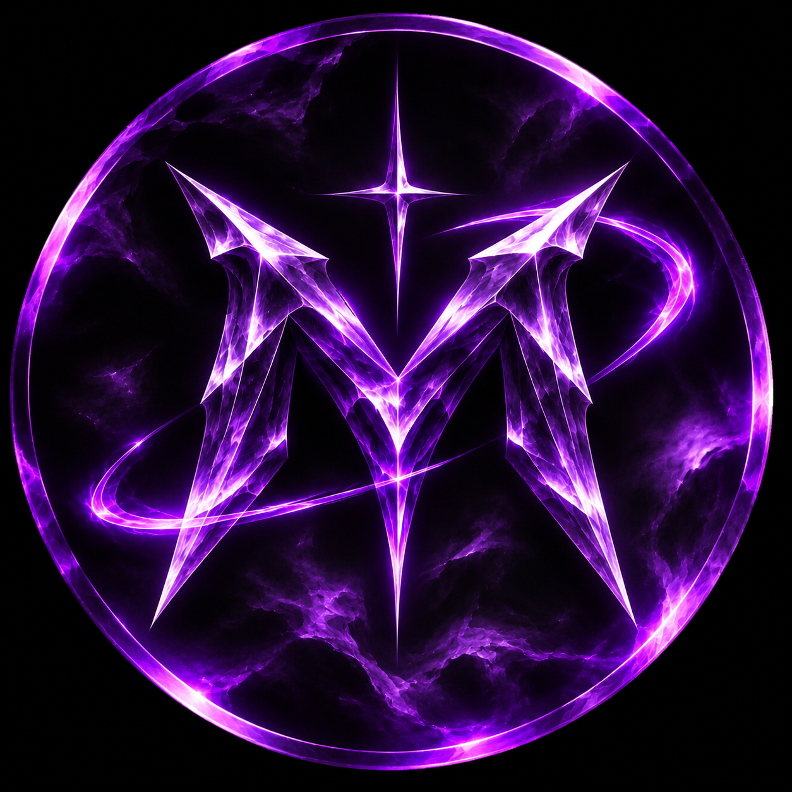

# ✦ Mirage




**Above all. Answers to one.** Mirage is an all-powerful server management bot. It sits at the top of your role list, can do almost anything in the server, and **answers only to its owner**.

## How the "owner" works
- **Owners** are you (put your user ID in `OWNER_IDS`) plus the server owner.
- Owners can use **every** command, even without any Discord permissions.
- Owners **can never be targeted**. Mirage refuses to ban, kick, time out, warn, rename or take roles from an owner, whoever asks.
- Everyone else needs the matching Discord permission, and can only act on members and roles **below** their own highest role.

## Commands

| Area | Commands |
|---|---|
| **Moderation** | `/ban` (incl. softban), `/unban`, `/kick`, `/timeout`, `/warn add·list·remove·clear`, `/purge` (filter by user, bots, text), `/nick`, `/slowmode` |
| **Lockdown** | `/lock channel·unlock` for one channel, `/lock server` to lock **everything** in an emergency, `/lock endlockdown` |
| **Roles** | `/role give·take·create·delete·edit·info`, `/role all` to give or take a role from every member |
| **Channels** | `/channel create·delete·rename·topic·clone·hide·show`, `/channel nuke` to wipe a channel by recreating it |
| **Server** | `/server info·name·icon·verification`, `/server check` (tells you what's missing for full power) |
| **Messages** | `/say` (plain or embed, multi-line pop-up), `/dm` |
| **Config** | `/config modlog·welcome·autorole·view` |
| **General** | `/help`, `/ping`, `/userinfo`, `/avatar` |

Everything Mirage does is logged to the mod log channel once you set one with `/config modlog`.

## Setup (works from a phone)

Mirage is a **separate bot** from Destiny, with its own application and token.

**1. Create the bot:** <https://discord.com/developers/applications> → **New Application** → `Mirage`.
- **Bot** → **Reset Token** → copy it.
- On the same page, turn on **Server Members Intent**. You need it for welcome messages, auto-role and `/role all`.
- The profile picture and banner set themselves on first start. You can also upload `assets/avatar.png` manually.

**2. Invite it with Administrator.** Replace `APP_ID` with the Application ID:
```
https://discord.com/oauth2/authorize?client_id=APP_ID&scope=bot%20applications.commands&permissions=8
```

**3. Put Mirage above everyone.** Go to **Server Settings → Roles** and drag the **Mirage** role to the very **top**.
Discord doesn't let a bot move its own role up, so a person has to do this once. The server owner is always above every role. If you're not the server owner, your own role must be above Mirage's for you to drag it.

**4. Host it on Railway** as a second service in the same project:
1. **New** → **GitHub Repo** → `destiny-bot` (same repo).
2. **Settings** → **Root Directory** = `mirage`. Set the branch if needed.
3. **Variables**:
   - `DISCORD_TOKEN` = Mirage's token
   - `OWNER_IDS` = your user ID. To get it, turn on Developer Mode in Discord settings, then long-press your name → Copy User ID.
   - `DATABASE_PATH` = `/data/mirage.db`
4. **Add a Volume** mounted at `/data`.

**5. Check it:** run `/server check` in your server. Every line should be ✅.

### Troubleshooting
| Problem | Fix |
|---|---|
| "highest role is above mine" | Drag Mirage's role higher (step 3) |
| "Running without Server Members Intent" in logs | Turn on Server Members Intent (step 1) and redeploy |
| "Discord rejected the token" | Reset the token and update `DISCORD_TOKEN` |
| Commands missing | Restart Discord; check the logs say "Registered … commands" |

### Running on a computer
```bash
cd mirage
npm install
cp .env.example .env   # set DISCORD_TOKEN and OWNER_IDS
npm start
```
`npm run check` runs an offline self-test.
